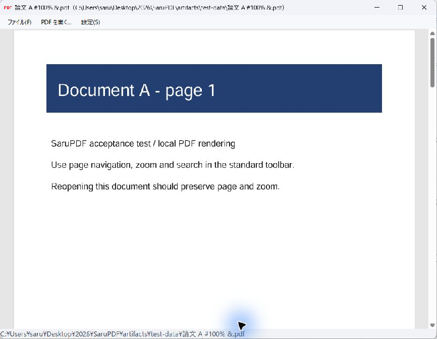

# SaruPDF

Windows向けのPDF Viewer・ページ編集アプリです。1文書につき1つのウィンドウが開きます。同じPDFをもう一度開くと、既存のウィンドウへ移動します。ページ番号などのツールバーを省き、文書を広く表示します。

**[ダウンロード（Windows x64・インストーラー.exe）](https://github.com/sarulab-ou/SaruPDF/releases/download/v0.3.0/SaruPDF-0.3.0-Setup-x64.exe)** · [使い方](#使い方) · [開発・ビルド](docs/development.md)



_SaruPDF v0.2.1の実画面。自動テストで生成した検証用PDFを表示しています。_

## できること

- **1文書、1ウィンドウ。** PDFを好きな位置に並べて使えます。移動・サイズ変更・最小化・最大化をそれぞれ操作でき、Alt+Tabやタスクバーから選べます。タブはありません。
- **同じPDFは同じウィンドウへ。** アプリ内から開く場合も、Explorerなどから追加起動した場合も、既存の文書へ移動します。最小化中なら復元し、現在のページやズームは保持します。
- **文書を広く表示。** ページ番号などのPDFツールバー行は非表示です。スクロールに加え、数字を入力してEnterを押すと指定ページへ移動できます。
- **ページを切り取り、好きな位置へ。** 「編集 → 編集モード」でページ一覧を表示し、1ページずつ切り取り・貼り付けで順番を変更できます。元に戻す・やり直し、上書き保存・名前を付けて保存に対応します。
- **ファイルの場所が分かる。** タイトルは「ファイル名（フルパス）」です。下端のパス欄からも確認・コピーできます。
- **PDFを開くアプリとして登録。** インストール時、または「設定 → PDF の関連付け」から、Windowsの「プログラムから開く」の候補に登録できます。
- **日本語や空白を含むパスに対応。** 複数のPDFをまとめて渡せます。同名でも異なるフォルダーのPDFは別の文書として開きます。

## ダウンロード・インストール

**[SaruPDF v0.3.0 Windows x64インストーラーをダウンロード](https://github.com/sarulab-ou/SaruPDF/releases/download/v0.3.0/SaruPDF-0.3.0-Setup-x64.exe)**

[リリースノート](https://github.com/sarulab-ou/SaruPDF/releases/tag/v0.3.0) · [SHA-256チェックサム](https://github.com/sarulab-ou/SaruPDF/releases/download/v0.3.0/SaruPDF-0.3.0-SHA256SUMS.txt) · [ソースからのビルド](docs/development.md)

1. `SaruPDF-0.3.0-Setup-x64.exe`をダウンロードし、**Windows 10 / 11 x64**で実行します。現在のユーザー用にインストールするため、管理者権限は不要です。
2. **WebView2 Runtimeが必要です。** インストーラーには含まれません。不足している場合は、アプリが案内する[Microsoft公式サイト](https://developer.microsoft.com/microsoft-edge/webview2/#download-section)からEvergreen Runtime（x64）をインストールし、SaruPDFを再起動してください。.NET Runtimeは同梱しています。
3. `.pdf`をダブルクリックで開きたい場合は、Windowsの既定アプリ設定でSaruPDFを選択します。完了画面の「PDF の関連付け設定を開く」から設定できます。

更新する場合は、SaruPDFの全ウィンドウを閉じてからインストーラーを実行してください。保存先の既定値は`%LOCALAPPDATA%\Programs\SaruPDF`です。

配布するEXEとインストーラーは未署名です。Windows 11での実画面確認と自動テストを実施しています。Windows 10・WebView2未導入PCでの受け入れ確認は未完了です。[検証記録](docs/verification.md)を参照してください。

リポジトリが非公開の場合、ダウンロードにはGitHubへのログインとアクセス権が必要です。

## 使い方

1. スタートメニューの**SaruPDF**を起動します。
2. **「PDF を開く」またはCtrl+O**でファイルを選びます。複数選択もできます。最初のPDFは、起動時の空ウィンドウに表示します。
3. 文書をスクロールして読みます。**数字を入力してEnter**でもページを移動できます。たとえば`12`→Enterで12ページ目へ移動します。入力中だけ右上に案内が出ます。Backspaceで修正、Escで取り消せます。別のPDFを開くと、新しいウィンドウに表示します。すでに開いているPDFなら、そのウィンドウへ移動します。
4. **Ctrl+W**で現在のウィンドウだけを閉じます。ほかの文書は残り、最後のウィンドウを閉じるとアプリが終了します。

PDFの右クリックから「プログラムから開く」→「別のプログラムを選択」→**SaruPDF**でも開けます。候補にない場合は、インストール先の`SaruPDF.exe`を指定してください。

## ページを編集する

1. PDFを開き、**「編集 (E) → 編集モード」**を選びます。左側にページ一覧が表示されます。
2. 移動するページを選び、**「切り取り」またはCtrl+X**を押します。
3. 挿入先のページを選び、**「貼り付け」またはCtrl+V**を押します。選んだページの**前**に挿入します。最後に移動する場合は一覧の**「末尾（ここに貼り付け）」**を選びます。
4. **Ctrl+S**で上書き保存、**Ctrl+Shift+S**で名前を付けて保存します。保存するまでは元のPDFを変更しません。

たとえば「1、2、3、4」の2ページ目を切り取り、末尾に貼り付けると「1、3、4、2」になります。**Ctrl+Z**で元に戻し、**Ctrl+Y**でやり直せます。切り取り中のページは、貼り付けるまで保存できません。

編集モードを解除するときやウィンドウを閉じるとき、未保存の変更があれば保存するか確認します。編集中に元ファイルが別のアプリで変更された場合は、上書きせず、名前を付けて保存してください。別名で保存すると、その保存先が現在の文書になります。

この版の切り取り・貼り付けは**同じPDF内のページ移動**です。Windowsのテキスト用クリップボードは使用しません。暗号化・パスワード付きPDFや署名欄のあるPDFの編集には対応していません。

## PDFの関連付け

インストーラーの「PDF を開くアプリの候補に登録」は初期状態で選択されています。アプリの**「設定 → PDF の関連付け」**や、スタートメニューの**「SaruPDF → PDF の関連付け」**からも登録できます。

既定のPDFアプリにするには、**「登録して Windows の既定アプリ設定を開く…」**を押し、Windowsの画面で`.pdf`のアプリとしてSaruPDFを選択します。候補登録だけでは、現在の既定アプリを変更しません。

アンインストールはWindowsの「インストールされているアプリ」から行えます。SaruPDFを既定にしていた場合は、Windowsの画面で次のPDFアプリを選択してください。

## 主なショートカット

| 操作 | キー |
| --- | --- |
| PDFを開く | Ctrl+O |
| 編集メニュー | Alt+E |
| ページを切り取り／貼り付け（編集モード） | Ctrl+X / Ctrl+V |
| 元に戻す／やり直し（編集モード） | Ctrl+Z / Ctrl+Y |
| 保存／名前を付けて保存（編集モード） | Ctrl+S / Ctrl+Shift+S |
| 指定ページへ移動 | 数字 → Enter（テンキーも使用可） |
| ページ番号の修正／取り消し | Backspace / Esc |
| 現在のウィンドウを閉じる | Ctrl+W / Alt+F4 |
| ファイルメニュー | Alt+F |
| 設定メニュー | Alt+S |
| ウィンドウを切り替える | Alt+Tab |

## コマンドから開く

インストール先をカレントディレクトリにした場合の例です。

```powershell
.\SaruPDF.exe "C:\Documents\論文 A.pdf"
.\SaruPDF.exe "C:\Documents\論文 A.pdf" "C:\Documents\論文 B.pdf"
```

相対パスは起動元のカレントディレクトリを基準に解決します。引数なしで追加起動した場合は、既存のウィンドウへ移動します。

## ファイルの扱いと制限

- PDFはローカルで表示し、SaruPDFが文書を外部サービスへアップロードする処理はありません。WebView2自身の更新・ネットワーク動作はMicrosoftの製品仕様に従います。
- 本文の文字・画像の編集、ページの削除・別PDFとの結合、独自の注釈編集は未実装です。編集モードは同じPDF内のページの並べ替えに対応します。
- ページの内容・回転・基本的な注釈・しおりの参照先を保持する試験を実施しています。特殊なフォーム、PDF/A・PDF/UA、ページラベルなど全機能の保持は検証していません。
- 同じPDFかどうかは、正規化した完全パスで判定します。シンボリックリンク・ハードリンク・短縮名など、別名を経由した同一判定は未対応です。
- 外部アプリが同じパスのPDFを置換しても、既存ウィンドウを優先します。最新版を表示するには、そのウィンドウを閉じて開き直してください。
- 数字＋Enterのページ移動時はPDFを再表示します。ズームなどの表示状態や、総ページ数を超える番号の扱いはWebView2に依存します。
- 文書の置き換えを防ぐため、表示領域への外部ドラッグ＆ドロップは無効です。破損・暗号化・特殊なPDF機能への対応はWebView2に依存します。
- 通常権限での使用を前提とします。管理者権限と通常権限を混在させると、追加起動の引き継ぎができない場合があります。

## 開発

C#、.NET 10、Windows Forms、Microsoft Edge WebView2で実装しています。Windows x64、PowerShell 7以降、.NET 10.0.403 SDKが必要です。

```powershell
.\scripts\Build.ps1
.\scripts\Test.ps1
```

SDKやインストーラー用ツールの準備、配布用ビルド、GitHub Releasesへの掲載は[開発・ビルドガイド](docs/development.md)を参照してください。自動テストは43件で、文書管理・関連付け・ショートカットに加え、ページ編集・保存・失敗時の元ファイル保護と実際のPDF描画を検査します。

[検証記録](docs/verification.md) · [サードパーティー通知](THIRD-PARTY-NOTICES.md)
