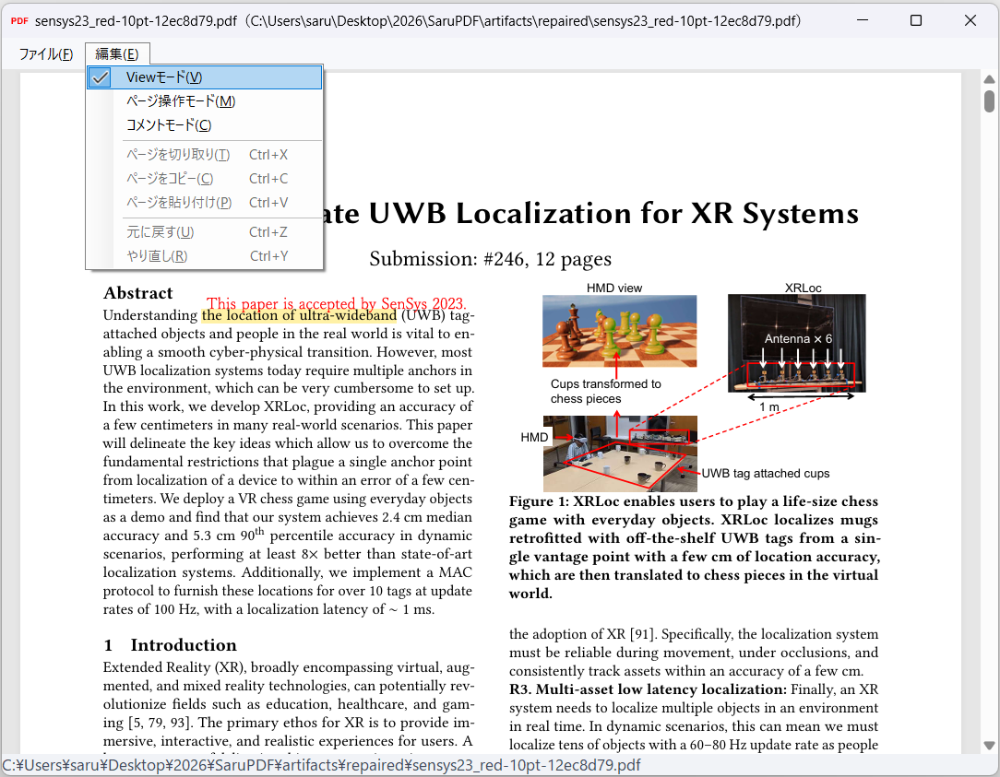

# SaruPDF

Windows向けのシンプルなPDFビューアー・ページ操作アプリです。余分なツールバーやページ一覧を表示せず、PDFを広く表示します。ページの並べ替えや、本文へのコメントもPDF画面上で操作できます。

**[Windows版をダウンロード](https://github.com/sarulab-ou/SaruPDF/releases/download/v0.7.3/SaruPDF-0.7.3-Setup-x64.exe)** · [使い方](#使い方) · [ショートカット](#ショートカット) · [開発・ビルド](docs/development.md)



*PDFを表示しながら「編集」メニューでモードを切り替えます。ハイライトに重ねて赤字のコメントを表示できます。*

## 特徴

- **広いPDF表示** — ページ番号などのツールバーを表示せず、数字を入力してEnterを押すだけで指定ページへ移動できます。
- **PDF画面でページ操作** — ページを直接選択し、切り取り・貼り付けで並べ替えます。複数ページの選択や、別のPDFへのコピーにも対応します。
- **本文にコメント** — 文字を選んでコメントを追加し、ハイライトと赤字で表示します。PDF標準の注釈として保存します。
- **1文書につき1ウィンドウ** — PDFを並べて閲覧できます。同じPDFを開き直した場合は既存のウィンドウに移動します。
- **ファイルの場所を表示** — タイトルバーにファイル名とフルパスを表示します。

## ダウンロード・インストール

**[SaruPDF v0.7.3 インストーラー（Windows x64）](https://github.com/sarulab-ou/SaruPDF/releases/download/v0.7.3/SaruPDF-0.7.3-Setup-x64.exe)**

[リリースノート](https://github.com/sarulab-ou/SaruPDF/releases/tag/v0.7.3) · [SHA-256チェックサム](https://github.com/sarulab-ou/SaruPDF/releases/download/v0.7.3/SaruPDF-0.7.3-SHA256SUMS.txt) · [すべてのリリース](https://github.com/sarulab-ou/SaruPDF/releases)

現在の公開版は **v0.7.3** です。

1. Windows 10（1809以降）またはWindows 11のx64環境でインストーラーを実行します。現在のユーザー用にインストールするため、管理者権限は不要です。
2. **WebView2 Runtime**が必要です。インストールされていない場合は、アプリの案内に従い[Microsoft公式サイト](https://developer.microsoft.com/microsoft-edge/webview2/#download-section)からEvergreen Runtime（x64）を入れてください。.NET Runtimeは同梱しています。
3. PDFをダブルクリックで開くには、インストール完了画面からWindowsの既定アプリ設定を開き、`.pdf`のアプリにSaruPDFを選択します。

更新時はSaruPDFの全ウィンドウを閉じてからインストーラーを実行してください。既定のインストール先は `%LOCALAPPDATA%\Programs\SaruPDF` です。配布するEXEとインストーラーは未署名です。Windows 10やWebView2未導入PCでの受け入れ確認は未完了です。[検証記録](docs/verification.md)も参照してください。

## 使い方

### PDFを開く

SaruPDFを起動し、**ファイル → PDF を開く**または **Ctrl+O** でPDFを選択します。複数のPDFを選択すると、文書ごとにウィンドウが開きます。Explorerの「プログラムから開く」からも利用できます。

起動時は **Viewモード** です。スクロールで文書を読み、数字を入力してEnterを押すと指定ページに移動します。たとえば `12` → Enter で12ページ目に移動します。入力中はBackspaceで修正、Escで取り消せます。

**編集**メニューで次のモードを切り替えます。

| モード | 操作 |
| --- | --- |
| Viewモード | PDFの閲覧、文字の選択やリンクの操作 |
| ページ操作モード | ページの選択、並べ替え、コピー、PDFのインポート |
| コメントモード | 本文の選択、コメントの追加・編集 |

モードを切り替えても表示倍率を引き継ぎます。ページ操作モードではWindows 11のタイトルバーが青色、コメントモードでは緑色になります。未保存の変更があるときは、モードの切り替えや終了の際に保存するか確認します。

### ページを並べ替える・コピーする

1. **編集 → ページ操作モード**を選び、PDF上のページをクリックします。Ctrl+クリックで離れたページを追加・解除、Shift+クリックで範囲選択できます。
2. **Ctrl+X**で切り取り、挿入先のページ間を右クリックして**「ここに貼り付け」**を選びます。複数ページは元の順番でまとめて挿入されます。
3. **Ctrl+S**で保存します。元のPDFを残す場合は**Ctrl+Shift+S**で名前を付けて保存します。

コピーするときはページを選んで**Ctrl+C**を押し、別のPDFのページ操作モードで貼り付けます。コピー元は変更されません。コピーしたページはSaruPDF内で共有され、アプリを終了すると消去されます。他のPDFアプリとのページの受け渡しには対応していません。

ページ間の右クリックメニューから**「ここにPDFをインポート…」**を選ぶと、別のPDFの全ページを挿入できます。複数ファイルをまとめて選択することもできます。操作はCtrl+Zで元に戻せます。

ページ操作モードではページを画像として画面に表示しますが、保存するPDF自体は画像化しません。切り取り中のページは、貼り付けるまで保存できません。外部アプリで元ファイルが変更された場合は上書きせず、別名で保存してください。

### コメントを付ける

1. **編集 → コメントモード**を選びます。
2. 本文を**マウスでドラッグ**するか、キャレットを移動しながら**Shift**を押して文字を選択します。
3. **Enter**、または右クリックの**「コメントを追加」**でコメントを入力します。コメント欄のEnterは改行、Ctrl+Enterは確定です。
4. **Ctrl+S**で保存します。SaruPDFで作成したコメントは、ハイライトや赤字をクリックするか、右クリックして**「コメントを編集」**を選ぶと変更できます。

コメントはハイライトに少し重ねた**10 ptの赤字**で表示します。文字には細めの明朝体を使用し、先頭をハイライトの先頭に合わせ、ページの右端で折り返します。長いコメントは表示枠内に収まる範囲を表示し、クリックすると全文を確認できます。

2段組と判定できる本文では、同じ段を上から下まで選択してから次の段へ進みます。本文と選択範囲は、PDF標準のHighlight・FreeText注釈としてPDF本体に保存します。SaruPDFでは吹き出しマークを表示しないようにしていますが、他のビューアーでは表示方法が異なることがあります。既存のSaruPDFコメントの表示を新しい配置に更新するには、コメントモードで名前を付けて保存してください。

## ショートカット

| 操作 | キー |
| --- | --- |
| PDFを開く | Ctrl+O |
| ページ番号を指定 | 数字 → Enter |
| ページの選択・移動（ページ操作モード） | ↑ / ↓ / PgUp / PgDn / Home / End |
| ページを範囲選択（ページ操作モード） | Shift+移動キー、Shift+クリック |
| ページを追加・解除／全選択（ページ操作モード） | Ctrl+クリック / Ctrl+A |
| ページを切り取り／コピー／貼り付け（ページ操作モード） | Ctrl+X / Ctrl+C / Ctrl+V |
| 拡大・縮小（ページ操作モード） | Ctrl+「+」/ Ctrl+「-」/ Ctrl+ホイール |
| 文字を選択（コメントモード） | マウスドラッグ / Shift+移動キー |
| コメントを追加（コメントモード） | 文字を選択してEnter / 右クリック |
| 元に戻す／やり直す | Ctrl+Z / Ctrl+Y |
| 保存／名前を付けて保存 | Ctrl+S / Ctrl+Shift+S |
| 現在のウィンドウを閉じる | Ctrl+W / Alt+F4 |

## PDFの関連付け

インストール時、SaruPDFを「プログラムから開く」の候補として登録できます。後から登録する場合は、スタートメニューの**SaruPDF → PDF の関連付け**を開きます。既定のPDFアプリにするには、Windowsの既定アプリ設定で`.pdf`にSaruPDFを選択してください。候補への登録だけでは既定アプリは変更されません。

アンインストールはWindowsの「インストールされているアプリ」から行えます。

## 制限事項

- 画像だけのスキャンPDFでは文字を選択できません。OCRは行いません。複雑な段組みや縦書きでは読み順や選択範囲が一致しない場合があります。
- 本文の文字・画像の編集、ページの削除、コメントの削除は未対応です。他のアプリで作成した注釈は閲覧できますが、編集には対応していません。
- 暗号化・パスワード付きPDFや署名欄のあるPDFの編集には対応していません。
- 別のPDFからページをコピーする際、文書全体のしおりやフォーム構造は移植しません。複雑な注釈、ページ間リンク、PDF/A・PDF/UAなどの完全な保持は未検証です。
- PDFはローカルで表示し、SaruPDFが文書を外部サービスへアップロードする処理はありません。WebView2自身の通信はMicrosoftの製品仕様に従います。

## 開発

C#、.NET 10、Windows Forms、Microsoft Edge WebView2で実装しています。Windows x64、PowerShell 7以降、.NET 10.0.403 SDKが必要です。

```powershell
.\scripts\Build.ps1
.\scripts\Test.ps1
```

ビルドやインストーラー作成の詳細は[開発・ビルドガイド](docs/development.md)を参照してください。現在のソースの自動テストは80件です。

[検証記録](docs/verification.md) · [サードパーティー通知](THIRD-PARTY-NOTICES.md)
